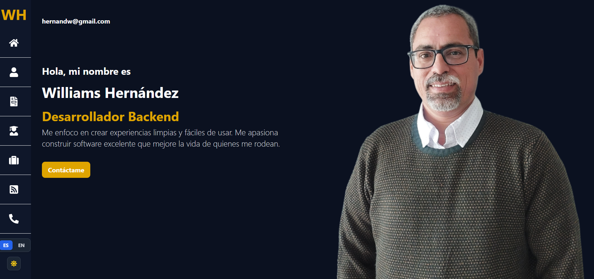
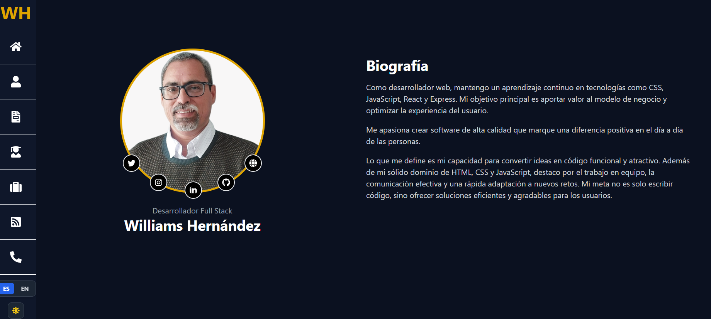
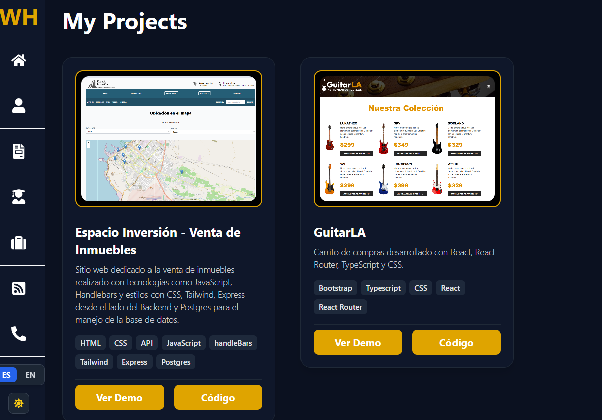
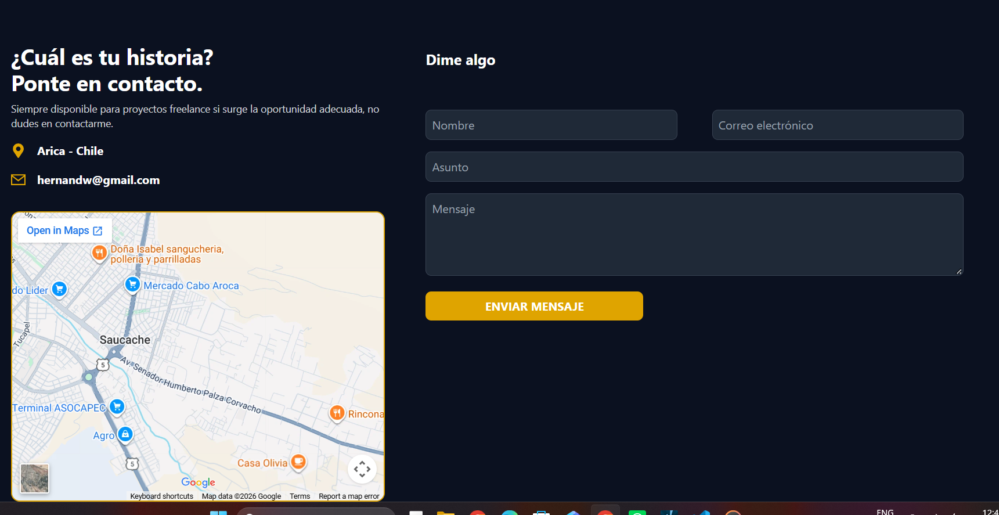

# 🌐 Williams Antonio Hernandez Ardila — Portfolio Personal

<p align="center">
  
  
  
  
</p>

Repositorio oficial del sitio web y portfolio personal que aloja mi carta de presentación profesional, proyectos destacados, experiencia como desarrollador Full Stack y educador en programación.

---

## 📸 Recorrido Visual por el Portfolio

### 1. Sección Principal (Hero / Inicio)
> *Vista de bienvenida con el título principal, rol profesional y llamadas a la acción (CTA).*

<p align="center">
  
</p>

---

### 2. Sobre Mí y Habilidades Técnicas
> *Resumen de trayectoria profesional y stack tecnológico dominado (Frontend, Backend, Bases de Datos y Herramientas).*

<p align="center">
  
</p>

---

### 3. Proyectos Destacados
> *Galería interactiva de proyectos web desarrollados con arquitectura moderna, enlaces a repositorios y despliegues en vivo.*

<p align="center">
  
</p>

---

### 4. Contacto y Redes
> *Sección final con canales directos de comunicación, enlaces profesionales y perfiles.*

<p align="center">
  
</p>

---

## 🚀 Tecnologías y Herramientas

Este proyecto está construido utilizando tecnologías web modernas para garantizar un rendimiento óptimo, diseño adaptable (*responsive*) y una experiencia de usuario fluida:

* **Core:** HTML5, CSS3, JavaScript (ES6+)
* **Frameworks & Librerías:** React, Vite
* **Estilos:** Tailwind CSS
* **Control de Versiones:** Git & GitHub Pages

---

## 🛠️ Estructura del Repositorio

```text
hernandw.github.io/
├── assets/
│   └── images/           # Capturas de pantalla para la documentación
├── src/                  # Código fuente de la aplicación (Componentes, vistas, estilos)
├── public/               # Recursos estáticos globales
├── index.html            # Punto de entrada HTML
├── package.json          # Dependencias y scripts del proyecto
└── README.md             # Documentación principal